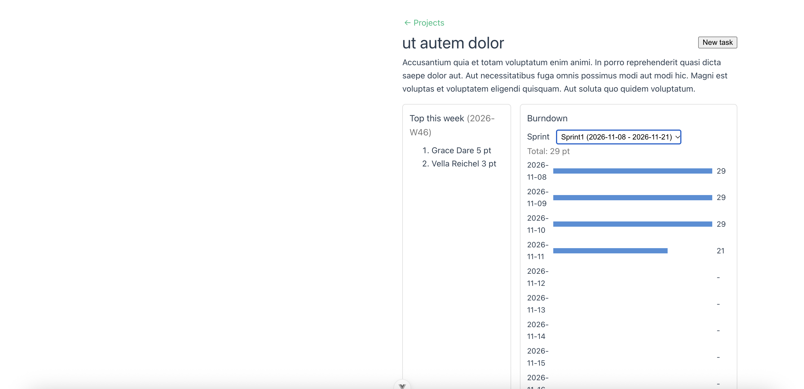

# Sprint Taskboard

[](https://github.com/naoki-takami0120/sprint-taskboard/actions/workflows/tests.yml)

A sprint task board with a Laravel REST API and a Vue 3 single-page app. I built it to practice the backend problems I care about most: access control, concurrent updates, caching, and background jobs.



## Features

- Token login (Laravel Sanctum). Projects have an owner, members, and an admin role.
- Tasks with pagination, filters, assignees, due dates, and points.
- A status workflow (to do, in progress, done) with transition rules, a history log, and `completed_at`.
- A weekly points ranking per project, kept in a Redis sorted set.
- A sprint burndown, cached in Redis and cleared when tasks change.
- Due-date notices sent by queued jobs, with retries.
- A Vue app with login, a project list, and a board that shows the ranking and the burndown.

## Tech stack

| Area | Tools |
|---|---|
| Backend | PHP (8.5.11), Laravel (13.38.0), Sanctum |
| Data | MySQL, Redis (ranking, cache, queue) |
| Frontend | Vue 3, Vite, Vue Router, Pinia |
| Environment | Docker (Laravel Sail) |
| Quality | PHPUnit (117 tests), Pint, ESLint, GitHub Actions with MySQL and Redis |

## Getting started

You need Docker, PHP with Composer, and Node 22.18+ or 24.12+.

```bash
git clone https://github.com/naoki-takami0120/sprint-taskboard.git
cd sprint-taskboard
cp .env.example .env
composer install
./vendor/bin/sail up -d
./vendor/bin/sail artisan key:generate
./vendor/bin/sail artisan migrate --seed
```

Start the Vue app in a second terminal:

```bash
cd frontend
npm install
npm run dev
```

Open http://localhost:5174 and sign in with `admin@example.com` / `password`.

The API runs at http://localhost. The Vue dev server proxies `/api` to it, so no CORS setup is needed.

### Background jobs

Due-date notices run on a queue. Notices are written to `storage/logs/laravel.log` (no mail server is set up).

```bash
./vendor/bin/sail artisan queue:work          # process queued jobs
./vendor/bin/sail artisan tasks:notify-due-soon   # queue notices now
./vendor/bin/sail artisan schedule:work       # run the daily schedule
./vendor/bin/sail artisan ranking:rebuild     # rebuild the ranking from the database
```

### Tests

```bash
./vendor/bin/sail artisan test
cd frontend && npm run lint && npm run build
```

## API overview

All endpoints except register and login need `Authorization: Bearer <token>`.

| Area | Endpoints |
|---|---|
| Auth | `POST /api/register`, `POST /api/login`, `POST /api/logout`, `GET /api/user` |
| Projects | `GET/POST /api/projects`, `GET/PUT/DELETE /api/projects/{project}` |
| Members | `GET/POST /api/projects/{project}/members`, `DELETE /api/projects/{project}/members/{user}` |
| Tasks | `GET/POST /api/projects/{project}/tasks`, `GET/PUT/DELETE /api/tasks/{task}`, `PATCH /api/tasks/{task}/status` |
| Sprints | `GET /api/projects/{project}/sprints`, `GET /api/sprints/{sprint}/burndown` |
| Ranking | `GET /api/projects/{project}/ranking` |

## Design notes

**Who can see and do what.** A user who is not a member gets 404, so the project's existence is not revealed. A member without permission gets 403. A request that breaks a rule (for example, removing the project owner) gets 422. Admins are handled in the policy's `before` hook, but they still need to be members to see a project.

**Status changes are concurrency-safe.** Status is changed only through a dedicated endpoint. It runs in a transaction, locks the row with `lockForUpdate`, checks the transition rule against the locked row, then updates the task and writes a history row. I tested this with 10 concurrent requests for the same change: with the lock, one history row was written. Without it, five.

**The ranking is a copy, not the source of truth.** The ranking lives in a Redis sorted set (one key per project and ISO week). It is updated in `DB::afterCommit`, so a rolled-back change never leaves points behind. If Redis is flushed, `ranking:rebuild` restores it from the tasks table.

**The burndown cache is cleared after commit.** A task observer clears the cached burndown from `DB::afterCommit`, including the old sprint when a task moves. The key contains today's date, so the cache rolls over at midnight.

**N+1 queries are caught by tests.** Adding the assignee name to the task list caused an N+1: 102 queries for 100 tasks. Eager loading brought it down to 3. A test checks that the query count does not grow with the number of tasks, and lazy loading is blocked outside production.

**Notices are safe to repeat.** The job carries only the task id and reloads the task when it runs. `due_notified_at`, a unique job lock, and a check at the start of the job keep a task from being notified twice. Failed jobs retry with a delay and end up in `failed_jobs`.

**The Vue app keeps its state in the URL and handles stale responses.** The page number and the assignee filter are in the query string. Each load has a request id, so a slow old response cannot overwrite a newer one. A shared handler in the API client sends the user to the login screen on any 401 and remembers the page, and the redirect target is checked to stay inside the app.

More detail, including the problems I hit along the way, is in [docs/devlog.md](docs/devlog.md).

## Known limitations

- Notices go to the log. No real mail server is configured.
- The Vue app cannot create sprints or assign a task to a sprint.
- The token is stored in `localStorage`. A cookie-based setup would reduce the XSS risk but needs CSRF protection.
- The front end has no automated tests yet.
- Burndown days use the application timezone (UTC).

## How I built it

I wrote and debugged the code myself, and used an AI assistant as a tutor and reviewer: it explained concepts, suggested designs, and reviewed my code. I decided what to build, ran everything, and fixed the failures. The devlog records what I did each day and what went wrong.